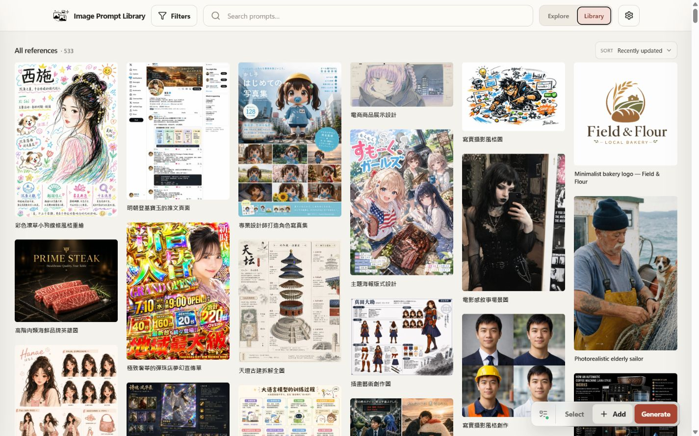
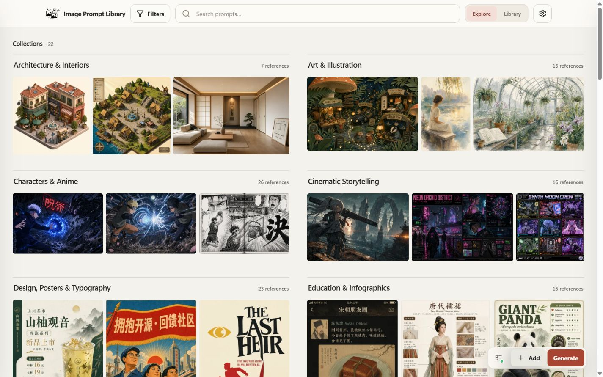
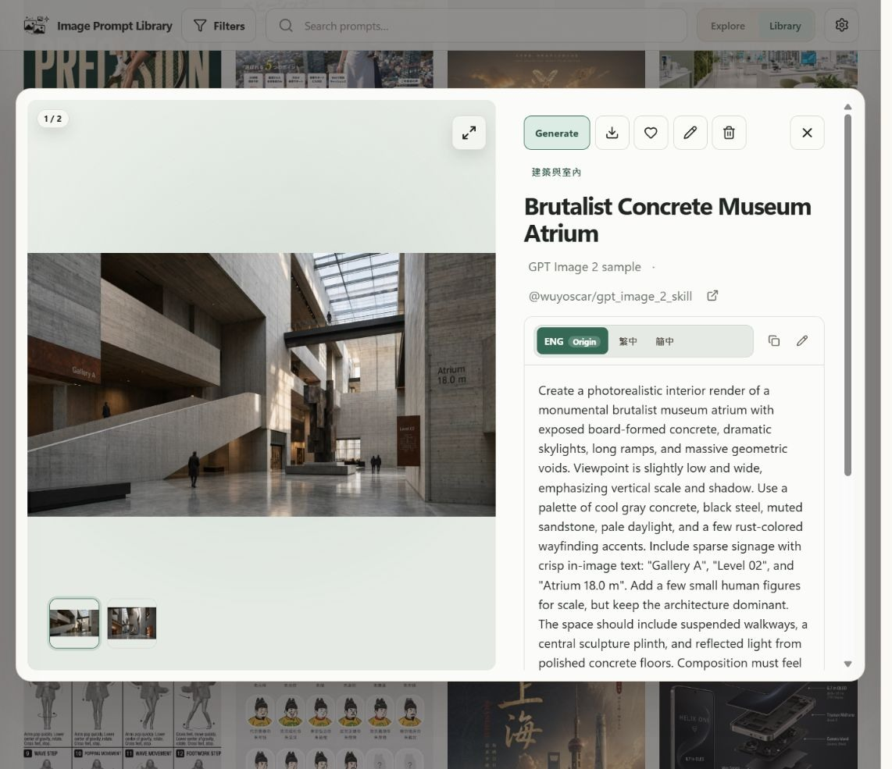
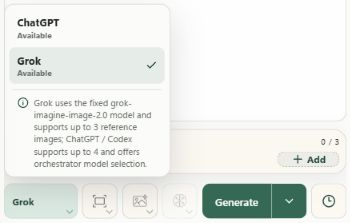
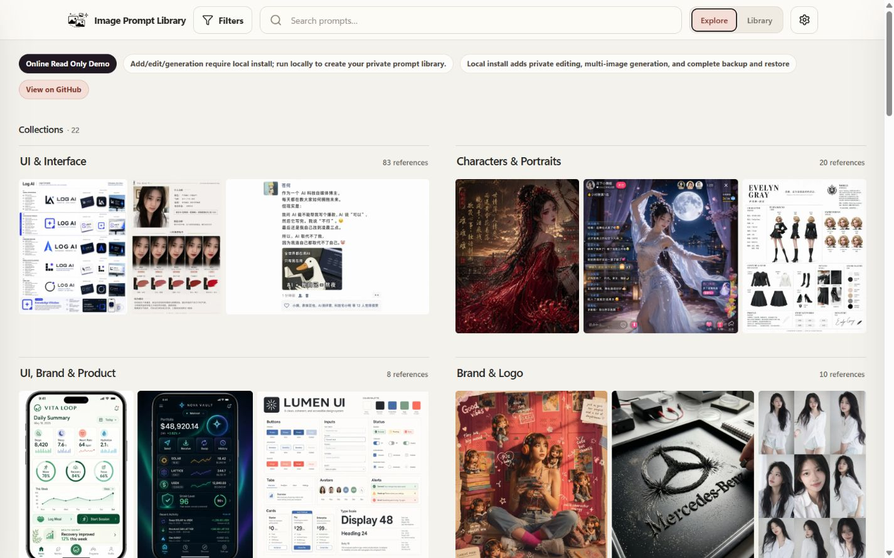

# Image Prompt Library

**Save the image, keep the prompt, and continue creating.** A local-first workspace for collecting image references, organizing a personal library, generating images, and refining ideas with an Agent.

[](https://github.com/Brilliant666/image-prompt-library/actions/workflows/ci.yml)
[](LICENSE)

**English** · [繁體中文](README_zh-TW.md) · [简体中文](README_zh-CN.md)

[Features](#features) · [Quick start](#quick-start) · [API and image settings](#api-and-image-settings) · [FAQ](#faq) · [Documentation](#documentation)

Your library uses local SQLite and local image files. Saving, browsing, searching and organizing need no generation account. Optional AI requests run on the selected provider's servers.

> **Independent maintenance:** maintained by [Brilliant666](https://github.com/Brilliant666/image-prompt-library), based on [EddieTYP/image-prompt-library](https://github.com/EddieTYP/image-prompt-library) **v0.11.2**. This repository is maintained from source; no release installer is offered. Do not overwrite this edition with an upstream installer or updater. This README describes the accompanying source, not a promise that every feature is in a published release or your installed copy. See [maintenance and setup](docs/INDEPENDENT_MAINTENANCE.md).

Upstream history: [v0.11.0 — Grok OAuth](docs/releases/v0.11.0.md) and [v0.11.2 — direct Images requests](docs/releases/v0.11.2.md) are retained as historical release notes from the original project, not current releases of this independent repository. Follow the source-maintenance instructions above rather than upstream installation or update commands.

<details>
<summary>📷 Preview the library — historical public screenshots</summary>







These existing screenshots use public sample material and show earlier library screens. They do not show the latest Gallery or Agent interface. A new library starts empty.

</details>

## Features

| Workspace | What you can do |
| --- | --- |
| **Explore** | Browse references by collection, search and sort, then open an image and copy its prompt. |
| **Library** | Manage image/prompt cards, language variants, tags, collections, favorites and Trash. |
| **Gallery** | Submit image requests, review queue/history, compare results and save selected images to Library. |
| **Agent** | Discuss ideas, reverse-engineer prompts and continue image creation with saved conversations and branches. |

### 🗂️ Capture and organize

- **Quick capture** saves a single image with its prompt and source. For browser collection, use the [local Chrome sidebar extension](docs/BROWSER_CAPTURE.md).
- Keep **multiple images in one card**, including result and reference images. In the full editor, upload, drop or paste image files, choose the cover, reorder images and preview changes before saving. Text paste still works in text fields.
- Keep original and translated prompts together; choose the language variant to read or copy. Reusable generation prompts can use `{{variables}}`, such as `{{subject}}`, when templates are enabled.
- Search titles, prompts, tags, collections, sources and notes; combine keywords with **structured search filters** such as `tag:portrait`, `collection:architecture` and `sort:title`. Change sorting and choose column-first or left-to-right card order in Library. Both arrangements keep the image above the card text.
- Select cards for bulk actions. **Tag** suggests existing tags; **Move** lets you search for a collection. Favorite, archive or move cards to Trash without editing each one separately.
- **Trash** preserves a deleted card's images, prompts and ordering for restoration. Permanent deletion requires separate confirmation and removes the record and image associations; image files remain on disk, so it does not immediately reclaim space. Records deleted before Trash existed are not recovered automatically.

### 🎨 Generate and collect

Enter a prompt in **Gallery**, select a provider/model and optionally add references from Library, history or uploaded, pasted or dropped image files. Choose one image or a 3/5/10-image set, then review current and historical tasks in **Gallery**.

- Inspect the original image, prompt, requested parameters and actual returned dimensions; zoom and pan in the lightbox or download selected originals as a ZIP.
- **Save as new item**, attach a result to its unchanged source card, or add later results to the card created from the first saved result.
- Restore a request for another attempt, or choose **Continue in Agent** to bring the image into a conversation. Adding a reference does not send a request.
- Gallery and Agent use the **same server-side generation queue and Library**. No second asset database or separate Node service is required.
- **Clear images** removes eligible uncollected result files from the Gallery view while retaining task records and original requests in history. It does not mean “delete records,” and already collected Library assets and protected references remain intact.

History initially loads 48 results and defaults to **All states**. Narrow it to **In progress**, **Success**, **Accepted** or **Failed**; the browser remembers your choice, and Success includes saved results. Cleared results are hidden from Gallery pages and counts, while their task records and original requests remain in execution history. Keyword search covers loaded pages, with **Load more** for older history. A tab-local metadata cache can show the previous list during refresh for up to 30 minutes. It holds no image bytes or credentials and cannot submit a request by itself.

If a completed image is retained but its local database registration fails, use
**Restore local result** on the original task rather than paying for generation
again. Import acceptance validates all staged images and commits the complete
asset atomically. See [local recovery and import safety](docs/LOCAL_RESULT_RECOVERY.md).

### 💬 Work with Agent

Agent keeps conversations, message branches and image references on the local server. Edit or regenerate a message to create a branch while retaining the earlier one. Search saved conversations, reuse generated images as references, and return from an output to its source conversation.

- **Continue naturally in chat.** The current task, working Prompt versions and image roles are maintained behind the conversation; no separate task form is required. Required older images are recovered from their specific sources instead of attaching every historical image merely because an old question is unresolved. Original text, images and branches remain saved.
- **Generate from a chosen Prompt block.** Use its exact text and the confirmed references with the visible image settings. Hybrid goes straight to the selected image-provider queue without another text-model planning request; Native uses its image tool. Image retry reuses the actual execution Prompt and frozen references. Unknown outcomes require checking the existing receipt and are never automatically replayed. See [confirmed Prompts and retry boundaries](docs/AGENT_CONFIRMED_RECIPES.md).
- **Copy the image or its Prompt explicitly.** Successful image cards offer separate image-copy and generation-Prompt actions. Clipboard conversion does not replace the original file; download it when you need the original bytes and metadata.
- **Understand failures before trying again.** Details distinguish upload limits, HTTP 413 request-size rejection, provider errors and uncertain outcomes. Available provider codes and a short sanitized explanation are shown without inventing a missing reason. Agent references accept PNG, JPEG and WebP, up to **30 MiB and 20,000,000 pixels per image**; unsupported or undecodable files have separate errors.
- Choose a compatible API profile and full **text model ID**. Hybrid mode uses Responses for text/tools and the selected image-protocol profile for image jobs; Native mode accepts Responses image-tool results. Provider support must match the selected route.
- **Continuous image mode is off by default.** Authorize images for one turn, or explicitly enable image mode to allow them on subsequent sends in the current conversation. Each request still freezes its image and model-step limits. Web search requires its own configuration and per-turn authorization.
- By default, **Enter sends** and **Shift+Enter inserts a new line**. Input-method composition does not submit. Accepted submissions clear text/references while keeping image settings; Gallery and Agent input preferences can be adjusted independently.
- **Use Gallery image settings** copies a valid image connection and parameters into the Agent draft without enabling generation or changing either prompt. OAuth and native Responses image-tool routes cannot be substituted this way.
- Built-in `image-prompt-reverse` and `gpt-image` guidance helps with image analysis, prompt refinement and edits. These are fixed, attributed text sections adapted from pinned sources, loaded when relevant; they do not install or automatically update the original skill repositories, run their scripts or authorize generation. See [Agent skills and licenses](docs/agent-skills/README.md).

Responses stream progress to the browser, with read-only polling as a fallback. Refreshing or reconnecting does not resubmit a paid request. **Stop** prevents new calls; an upstream request already sent may still finish or be billed. See [workspace behavior and compatibility limits](docs/PLAYGROUND.md).

The [offline preview](docs/AGENT_PREVIEW.md) uses synthetic images and a mock provider. It verifies application behavior, not real-model quality, provider latency or Prompt Cache gains. Actual operating-system image copy/paste still needs browser-specific manual acceptance; a mocked clipboard test is not that acceptance.

## Quick start

Use **Git, Python 3.10+** (3.11 recommended) and **Node.js 24** with npm.
Choose a path before installing:

| Goal | Guide |
| --- | --- |
| Full local app, first capture, data paths and health checks | [Step-by-step quick start (简体中文)](docs/QUICK_START.md) |
| Isolated development and tests | [Development Guide](docs/DEVELOPMENT.md) |
| Read-only showcase on Cloudflare Pages or Vercel | [Static deployment settings (简体中文)](docs/DEPLOYMENT.md#static-demo) |
| Full app on a persistent server, optionally behind Cloudflare Access | [Server deployment (简体中文)](docs/DEPLOYMENT.md#persistent-server) |

**First checkout:** use a new source folder. Existing users should inspect their
checkout and installed instance rather than cloning over them.

```sh
git clone https://github.com/Brilliant666/image-prompt-library.git
cd image-prompt-library
```

### Windows PowerShell

```powershell
python -m venv .venv
.\.venv\Scripts\python.exe -m pip install uv==0.12.16
$env:UV_PROJECT_ENVIRONMENT = Join-Path (Get-Location) '.venv'
.\.venv\Scripts\python.exe -m uv sync --locked --extra dev --inexact --python .\.venv\Scripts\python.exe
npm ci
npm run build
$env:IMAGE_PROMPT_LIBRARY_PATH = Join-Path $HOME 'ImagePromptLibrary'
.\.venv\Scripts\python.exe -m uvicorn backend.main:app --host 127.0.0.1 --port 8000 --workers 1
```

### macOS / Linux

```bash
python3 -m venv .venv
.venv/bin/python -m pip install uv==0.12.16
export UV_PROJECT_ENVIRONMENT="$PWD/.venv"
.venv/bin/python -m uv sync --locked --extra dev --inexact --python .venv/bin/python
npm ci
npm run build
export IMAGE_PROMPT_LIBRARY_PATH="$HOME/ImagePromptLibrary"
.venv/bin/python -m uvicorn backend.main:app --host 127.0.0.1 --port 8000 --workers 1
```

Open <http://127.0.0.1:8000/>; <http://127.0.0.1:8000/api/health> should return
JSON with `"ok": true`. Keep the terminal open; use `Ctrl-C` to stop gracefully.
Choose the library path first, keep port 8000 free and run only one process per
library. Direct `uvicorn` does not load a checkout `.env` automatically.
Credentials default to `~/.image-prompt-library`, outside the library.

A fresh local library starts empty. Use **Quick capture** to save one image and its original
Prompt. No AI account is required. For code changes use the isolated library,
credential paths and backend port 8010 in the [development guide](docs/DEVELOPMENT.md),
not your daily data. Vite runs on 5177 and proxies to the isolated backend.

The clone does not install a global management command. Only an existing managed
installation can use `image-prompt-library status` and `image-prompt-library doctor`.
Source changes do not update that separate installation. This independent repository
has no Releases yet; follow [source maintenance](docs/INDEPENDENT_MAINTENANCE.md) and
preserve compatible backups before changing a running version.

### Cloudflare / Vercel quick reference

For a **read-only demo**, set the project root to the repository root, install with
`npm ci`, build with `npx tsc && npx vite build --mode demo --base /`, and publish
**`frontend/dist`**. Select Node 24; Vercel must use the **Other** framework preset,
not automatic FastAPI detection. No model Key or private library is needed.

This is not the writable app: it cannot save private assets, run Gallery or Agent,
or replace the local backend. The default `npm run build:demo` uses the GitHub Pages
`/image-prompt-library/` subpath, so use the explicit root-base command above.
See [Cloudflare](docs/DEPLOYMENT.md#cloudflare-pages) / [Vercel](docs/DEPLOYMENT.md#vercel)
for exact settings, checks and limitations.

## API and image settings

Open **Settings → API → API Key connections**. Choose a service/protocol once,
enter name/Base URL/Key, optionally **Discover models before saving**, then save.
Named connections support `openai_compatible` (including sub2api and compatible
relays), `gemini_native` and `seedream_native`. A relay can expose a native format;
the app never infers protocol from a model name or retries a different route.
Account connections retain **ChatGPT / Codex OAuth** and experimental **Grok OAuth**;
the **Default AI provider** remains independently selectable.

| Setting | What it means |
| --- | --- |
| Model discovery | Unsaved drafts can read remote model lists without persisting a connection. Text/image/unknown labels are evidence-based; manual IDs remain supported. Seedream offers reference models, not a live Key test. |
| Text and images | Agent Hybrid uses a separate Responses text connection and the selected image protocol. Native Agent still uses its Responses image tool; native image profiles are not Gemini text-Agent support. |
| Connection changes | Changing an already filled type requires confirmation. Stored keys do not silently move to another URL/protocol. Discovery does not replace the image default with a text-only claim. |
| Image parameters | Gallery/Agent show applicable dimensions, ratio, quality, format and native options. The requested resolution is not a guarantee of returned pixels. Originals are retained. |
| Advanced settings | Address rules, network and protocol transport remain configurable. Models are in the main flow, not hidden behind advanced options. |
| Safety | Saving never runs a generation test. Unknown outcomes and retained local results are not automatically replayed. Real calls may send private content and incur charges. |

Read [API connections](docs/API_CONNECTIONS.md), [native image protocols](docs/NATIVE_IMAGE_PROVIDERS.md)
and [OpenAI compatibility](docs/OPENAI_COMPATIBLE.md) for detailed behavior.
A successful catalog read is not proof of model access, generation quality or billing.

<details>
<summary>Historical screenshot: Grok account provider selection</summary>



This public screenshot predates the current grouped API settings.

</details>

## Privacy

- Keep **your own private prompt/image library** on the machine running the backend: your computer by default, or your own persistent server. There is no hosted user database or built-in cloud sync; the app listens on `127.0.0.1` by default.
- Generation sends the prompt and selected references to the chosen provider. Agent also sends the selected conversation branch and required image context to its configured model; using a local library does not make AI inference local.
- **Suggest title** sends **only prompt text**. Review the suggestion and choose **Use title** to apply it. Generated-result suggestions show **via ChatGPT** or **via Grok**; if the chosen provider is unavailable, the app does not silently send the request elsewhere.
- Optional capture organization and visual naming use a separately configured vision service and **send image content**. Visual naming for a collected Gallery result requires the naming option and a configured, enabled organizer; it preserves a manually supplied title. This is separate from text-only title suggestions.
- Provider, OAuth, pairing and organizer credentials are stored outside the library and **excluded from portable backups**. Back up that external configuration separately when moving or restoring an installation.

## FAQ

<details>
<summary>Do I need an AI account to collect references?</summary>

No. Explore, Library, Quick capture and browser collection work without generation credentials. Only optional provider-backed operations need a compatible connection.

</details>

<details>
<summary>Why is a task missing from Gallery?</summary>

The default is **All states**, but the browser remembers your selected filter. Check that filter, load older pages or open the work queue/history. Cleared results stay hidden from Gallery pages and counts; their task records and original requests remain in history. Filtering never deletes tasks, and keyword search only covers loaded pages.

</details>

<details>
<summary>Does this include every feature from the Playground source?</summary>

No. The current adaptation does not include its canvas/comment system, paint-mask editor, local background removal or arbitrary asynchronous/custom HTTP providers. See the [capability table](docs/PLAYGROUND.md#source-adaptation-and-capability-status) for implemented features and verification limits.

</details>

## Online read-only demo

The [upstream online read-only demo](https://eddietyp.github.io/image-prompt-library/) lets you browse collections, search examples and copy public sample prompts. It is an upstream static showcase, not a hosted version of this independent edition or a preview of its latest Agent features.

<details>
<summary>Public sample demo screenshot</summary>



Editing, private-library management, and generation require the full app on your computer or persistent server, not this static demo.

</details>

## Sample data and attribution

The demo references and optional sample bundles retain source links and license information. Prompts and artwork belong to their respective sources. Import only the collection language you prefer:

```bash
image-prompt-library sample-data en
image-prompt-library sample-data zh_hans
image-prompt-library sample-data zh_hant
```

A larger Traditional Chinese pack is also available with `image-prompt-library sample-data zh_hant awesome-gpt-image-2`. Source titles, prompts and available language variants are preserved.

| Source | License | Pack |
| --- | --- | --- |
| [wuyoscar/gpt_image_2_skill](https://github.com/wuyoscar/gpt_image_2_skill) | CC BY 4.0 | Starter pack |
| [freestylefly/awesome-gpt-image-2](https://github.com/freestylefly/awesome-gpt-image-2) | MIT | Larger prompt/image gallery |

See [sample-data/README.md](sample-data/README.md) for details and checksums. Sample imports are separate from the Agent's built-in guidance.

## Documentation

[Local quick start (简体中文)](docs/QUICK_START.md) · [Deployment: Cloudflare / Vercel / servers (简体中文)](docs/DEPLOYMENT.md) · [API connections](docs/API_CONNECTIONS.md) · [Native image protocols](docs/NATIVE_IMAGE_PROVIDERS.md) · [Independent maintenance and source setup](docs/INDEPENDENT_MAINTENANCE.md) · [Workspaces and Agent](docs/PLAYGROUND.md) · [API profiles](docs/OPENAI_COMPATIBLE.md) · [Generation](docs/GENERATION.md) · [Browser capture](docs/BROWSER_CAPTURE.md) · [Backup and restore](docs/BACKUP_AND_RESTORE.md) · [Troubleshooting](docs/TROUBLESHOOTING.md) · [Development](docs/DEVELOPMENT.md) · [Contributing](CONTRIBUTING.md)

## License and acknowledgments

Application code retains **AGPL-3.0-or-later** and the original author notices. See [LICENSE](LICENSE) and [NOTICE](NOTICE). Commercial licenses mentioned in upstream documentation are not an offer or licensing commitment by this independent repository.

Gallery/Agent interactions and selected source code are adapted from [CookSleep/gpt_image_playground](https://github.com/CookSleep/gpt_image_playground), with its [MIT notice](licenses/Playground-MIT.txt) retained. Agent guidance has [separate source credits and licenses](docs/agent-skills/README.md); public sample data and third-party assets also retain their own licenses.
