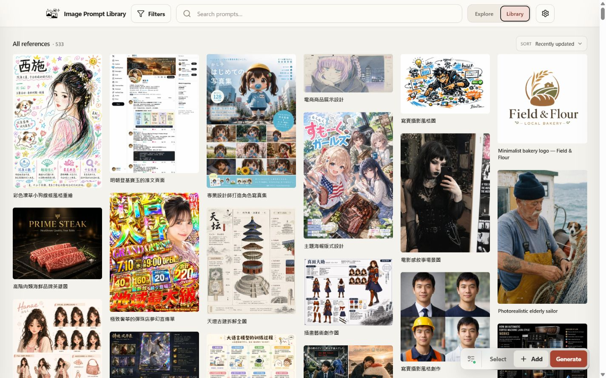
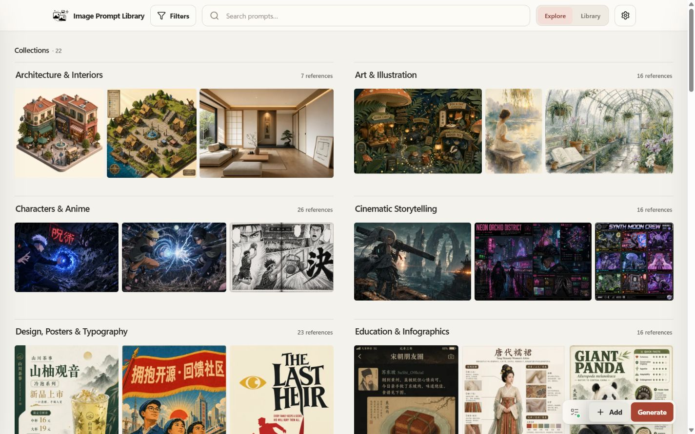
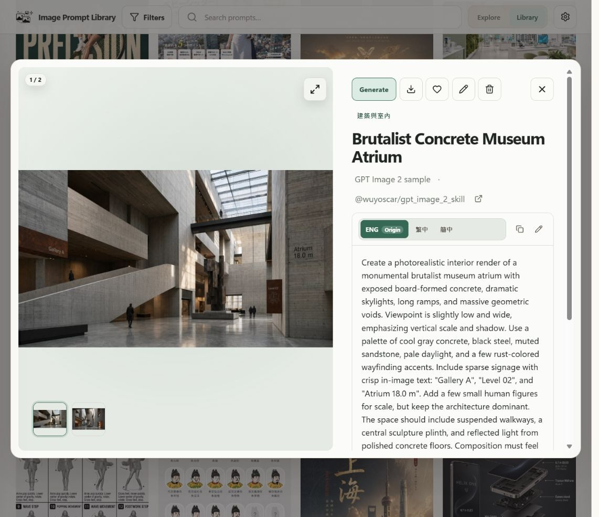
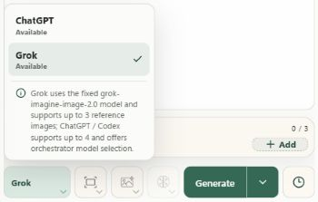
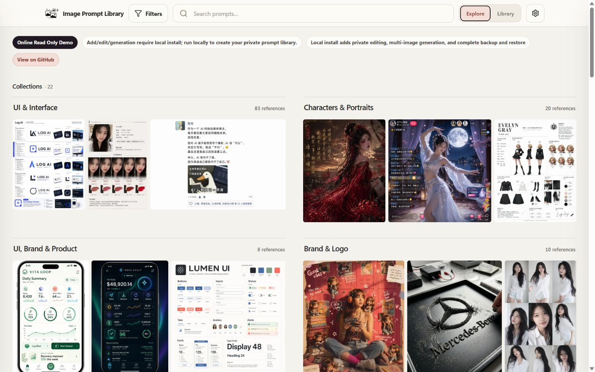

# Image Prompt Library

**保存图片和提示词，随时接着创作。** 一个本地优先的图片工作台，用于收集参考、整理个人图库、生成图片，并通过 Agent 推敲和完善想法。

[](https://github.com/Brilliant666/image-prompt-library/actions/workflows/ci.yml)
[](LICENSE)

[English](README.md) · [繁體中文](README_zh-TW.md) · **简体中文**

[核心功能](#核心功能) · [快速开始](#快速开始) · [API 与生图设置](#api-与生图设置) · [常见问题](#常见问题) · [文档](#文档)

图库使用本地 SQLite 和图片文件。保存、浏览、搜索和整理无需生图账号；可选的 AI 请求由所选供应商的服务器处理。

> **独立维护：** 本项目由 [Brilliant666](https://github.com/Brilliant666/image-prompt-library) 维护，基于 [EddieTYP/image-prompt-library](https://github.com/EddieTYP/image-prompt-library) **v0.11.2**。当前采用源码维护，尚无本仓库的 Releases 或发行安装包，请勿使用上游安装器或更新命令覆盖此版本。本 README 描述随附源码的功能，不代表这些功能均已发布或已安装到你的电脑。启动与更新方式见[独立维护说明](docs/INDEPENDENT_MAINTENANCE.md)。

上游历史：[v0.11.0 — Grok OAuth](docs/releases/v0.11.0.md) 与 [v0.11.2 — 直接 Images 请求](docs/releases/v0.11.2.md) 保留原项目的历史发行说明，不是本独立仓库的当前发行版。请遵循上方源码维护步骤，不要执行上游安装或更新命令。

<details>
<summary>📷 图库预览：历史公开截图</summary>







这些现有截图使用公开示例素材，展示较早的图库页面，不展示最新 Gallery 或 Agent 界面。新图库默认是空的。

</details>

## 核心功能

| 工作区 | 可以做什么 |
| --- | --- |
| **Explore** | 按集合浏览参考图，搜索、排序，打开图片并复制提示词。 |
| **Library** | 管理图片与提示词卡片、语言版本、标签、集合、收藏和回收站。 |
| **Gallery（画廊）** | 提交生图请求、查看队列与历史、比较结果，并将选中的图片收录到 Library。 |
| **Agent** | 讨论想法、反推提示词、继续图片创作，并保存会话和分支。 |

### 🗂️ 收录与整理

- **快捷收录**用于保存单张图片、提示词和来源。浏览网页时，可使用[本地 Chrome 侧栏收录插件](docs/BROWSER_CAPTURE.md)。
- **同一卡片可保存多张图片**，包括结果图和参考图。在完整编辑器中上传、拖入或粘贴图片文件，选择封面、调整顺序，并在保存前预览；文字输入框仍支持普通文本粘贴。
- 原始提示词和翻译一起保存，切换语言版本即可阅读或复制。启用模板后，生图提示词可使用 `{{variables}}`，例如 `{{subject}}`。
- 搜索标题、提示词、标签、集合、来源和备注，也可组合 `tag:portrait`、`collection:architecture`、`sort:title` 等结构化筛选。支持切换排序，Library 的纵向排列按列优先展示，横向排列按从左到右的顺序展示；两种排列都保持图片在上、文字在下的卡片结构。
- 选择多张卡片后批量操作：**Tag** 建议已有标签，**Move** 支持搜索目标集合，也可批量收藏、归档或移入回收站。
- **回收站**保留被删除卡片的图片、提示词和顺序，方便恢复。永久删除需要另行确认，会移除记录及图片关联；图片文件仍留在磁盘上，因此不会立即释放空间。回收站功能加入前已删除的记录不会自动恢复。

### 🎨 生图与收录结果

在 **Gallery** 输入提示词，选择供应商和模型，可从 Library、历史记录添加参考图，也可上传、粘贴或拖入图片文件。一次生成 1 张，或一组 3、5、10 张，并在 Gallery 查看当前及历史任务。

- 查看原图、提示词、请求参数和实际返回尺寸；在大图预览中缩放、平移，或将选中的原图打包下载为 ZIP。
- **另存为新条目（Save as new item）**，将结果附加到未被修改的来源卡片，或把后续结果加入第一张结果创建的卡片。
- 恢复请求参数后再次尝试，或选择**在 Agent 中继续**，把图片带入会话。添加参考图不会自动发送请求。
- Gallery 与 Agent 使用**同一套后端生成队列和 Library**，无需第二个素材数据库或独立 Node 服务。
- **清理图片**会从画廊隐藏符合条件、尚未收录的结果，并清理其结果文件；历史仍保留任务记录与原始请求。它不等于“删除记录”，已收录的 Library 资产及受保护的引用不会被清理。

历史初次加载 48 项，默认显示**全部状态**。可筛选**进行中、成功、已收录或失败**，浏览器会记住选择；成功结果包含已收录结果。清理后的结果不计入 Gallery 列表和数量，但任务记录及原始请求仍保留在执行历史中。关键词搜索仅覆盖已加载页面，更早的历史需点击**加载更多**。当前标签页可在刷新时展示最长保留 30 分钟的列表元数据缓存，其中没有图片文件或凭据，也不能单独发起请求。

已生成的图片若因本地数据库登记失败而待恢复，可在原任务点击**恢复本地结果**，无需再次付费生成。导入草稿会先验证全部暂存图片，再一次提交完整条目。详见[本地结果恢复与导入安全](docs/LOCAL_RESULT_RECOVERY.md)。

### 💬 使用 Agent 创作

Agent 在本地服务中保存会话、消息分支和图片引用。编辑或重新生成消息会创建新分支，并保留原分支。可以搜索已保存的会话，将生成图作为参考继续使用，也可从结果返回来源会话。

- **在聊天中自然继续任务。** 当前任务、工作提示词版本和图片角色由会话背后维护，不需要填写独立任务表。需要旧图时按具体来源取回，不会仅因旧问题尚未解决就附上全部历史图片；原文、原图和分支仍保留。
- **从选定的提示词块直接生图。** 使用该块的原文、已确认的参考图和当前可见图片设置。Hybrid 直接进入 Images 队列，不额外请求文本模型规划；Native 使用其图片工具。图片重试复用实际执行的提示词和冻结参考图；结果未知时应核对原回执，不会自动重放。详见[确认提示词与重试边界](docs/AGENT_CONFIRMED_RECIPES.md)。
- **明确选择复制图片或提示词。** 成功图片卡片分别提供复制图片和复制生成提示词。剪贴板转换不会替换原文件；需要原始字节和元数据时使用下载。
- **了解失败原因再尝试。** 详情区分上传限制、HTTP 413 请求大小拒绝、供应商错误和结果未知。显示可用的供应商错误码及脱敏后的简短说明，不猜测未提供的原因。Agent 参考图支持 PNG、JPEG、WebP，每张不超过 **30 MiB 和 16,000,000 像素**；不支持的格式与无法解码的文件会分别提示。
- 选择兼容的 API 配置及完整的**文本模型 ID**。Hybrid 模式通过 Responses 执行文本与工具请求，通过所选 Images 配置执行生图任务；Native 模式接收 Responses 图片工具的结果。供应商需要支持所选方式。
- **持续生图模式默认关闭。** 可以仅授权本轮生图，也可以主动开启生图模式，允许当前会话后续发送继续生成图片。每次请求仍会固定本轮的图片数量与模型步骤上限；网络搜索需要独立配置并逐轮授权。
- 默认 **Enter 发送，Shift+Enter 换行**，输入法选字期间不会发送。服务接受请求后清空已提交的文本和参考图，保留生图参数；Gallery 与 Agent 的输入偏好可以分别调整。
- **使用 Gallery 生图设置**会把有效的 Images 配置和参数复制到 Agent 草稿，不开启生图授权，也不改动两边的提示词。此操作不替代 OAuth 或原生 Responses 图片工具的配置。
- 内置 `image-prompt-reverse` 和 `gpt-image` 指南，辅助图片分析、提示词优化及编辑。这些是从固定来源版本改编、按需加载的有限文字章节，不会安装或自动更新原技能仓库、执行其脚本，也不会授予生图权限。详见 [Agent 技能与许可](docs/agent-skills/README.md)。

Responses 进度会实时推送至浏览器，连接不可用时退回只读轮询。刷新或重新连接不会重新提交付费请求。**停止**阻止新的调用，已经发送到供应商的请求仍可能完成或计费。详见[工作区行为与兼容限制](docs/PLAYGROUND.md)。

[离线预览](docs/AGENT_PREVIEW.md)使用合成图片和模拟供应商，验证应用流程，不代表真实模型质量、供应商延迟或 Prompt Cache 收益已通过验收。真实系统剪贴板的图片复制与粘贴仍需按浏览器手动验收，模拟剪贴板测试不能替代它。

## 快速开始

源码构建需要 **Python 3.10+** 和 **Node.js 24**。在已有源码目录中按照[独立维护说明](docs/INDEPENDENT_MAINTENANCE.md)操作。Windows PowerShell 示例：

```powershell
python -m venv .venv
.\.venv\Scripts\python.exe -m pip install uv==0.12.16
$env:UV_PROJECT_ENVIRONMENT = Join-Path (Get-Location) '.venv'
.\.venv\Scripts\python.exe -m uv sync --locked --extra dev --inexact --python .\.venv\Scripts\python.exe
npm ci
npm run build
$env:IMAGE_PROMPT_LIBRARY_PATH = Join-Path $HOME 'ImagePromptLibrary'
.\.venv\Scripts\python.exe -m uvicorn backend.main:app --host 127.0.0.1 --port 8000
```

启动前选择图库路径，确认没有其他实例占用同一图库，且 8000 端口空闲。打开 [127.0.0.1:8000](http://127.0.0.1:8000)，在终端按 `Ctrl-C` 停止。macOS/Linux 启动方式见[开发指南](docs/DEVELOPMENT.md)。

**开发与验证：**请使用[隔离开发示例](docs/INDEPENDENT_MAINTENANCE.md#从源码开发与启动)，同时隔离图库和凭据，并使用 8010 端口。上面的快速开始用于日常本地使用。

新图库默认是空的。选择**快捷收录**，加入图片与原始提示词即可保存，不必先配置 AI。已有安装版可使用以下命令检查状态：

```bash
image-prompt-library status
image-prompt-library doctor
```

修改或构建源码不会自动更新另一份已安装的程序。本独立仓库尚无 Releases；更新请遵循维护指南，并在切换版本前保留兼容的备份。

## API 与生图设置

打开**设置 → API**。API Key 配置支持 sub2api 等同步 OpenAI 兼容服务，可分别保存名称、基础地址、密钥、模型列表和默认值。账号连接保留 **ChatGPT / Codex OAuth** 和实验性的 **Grok OAuth**；单次生成可覆盖默认 AI 供应商。

| 设置 | 含义 |
| --- | --- |
| 模型目录 | **刷新模型**读取当前配置的模型列表。列表只是候选，不代表已验证 Images、Responses 或工具兼容性。手填及历史模型 ID 会保留；图片模型菜单优先推荐 `gpt-image` 名称，也允许手动输入完整模型 ID。 |
| 尺寸与比例 | 自动、比例预设和自定义尺寸决定请求像素。4K 目标不保证返回 4K，详情会区分请求与图片实际解码尺寸；不会拉伸已保存的原图。 |
| 质量与格式 | 可用设置取决于请求方式。透明输出需要 PNG 或 WebP，压缩仅在支持时适用；供应商可能拒绝或忽略可选参数。 |
| 流式输出 | 可选的 Images 流式输出和中间预览取决于接口支持。部分图片只是进度，不代表最终生成成功。 |
| 授权 | 保存或切换配置不会执行付费生图测试。OAuth 的访问权限、配额和费用仍由供应商决定。 |

接口规则、参考图限制和故障处理见 [OpenAI 兼容配置](docs/OPENAI_COMPATIBLE.md)与[生图指南](docs/GENERATION.md)。模拟测试不能确认真实供应商的模型身份、费用、分辨率或原生工具支持。

<details>
<summary>历史截图：选择 Grok 账号供应商</summary>



这张公开截图早于当前分组 API 设置界面。

</details>

## 隐私

- 私人图片与提示词图库保存在你的电脑，没有托管用户数据库或内置云同步；应用默认监听 `127.0.0.1`。
- 生图会将提示词和所选参考图发送至指定供应商。Agent 还会向配置的模型发送当前会话分支及所需图片上下文；图库本地保存不代表 AI 在本地运行。
- **建议标题（Suggest title）只发送提示词文本**。先检查建议，再选择 **Use title** 应用。生成结果的建议显示 **via ChatGPT** 或 **via Grok**；所选供应商不可用时，不会悄悄把请求改发到其他服务。
- 可选的收录整理与视觉命名使用单独配置的视觉服务，**会发送图片内容**。为 Gallery 收录结果进行视觉命名，需要选择命名选项，并配置、启用整理服务；手动填写的标题会保留。这与仅发送文本的标题建议是不同功能。
- 供应商、OAuth、配对和整理服务凭据保存在图库之外，**不包含在可移植备份中**。迁移或恢复安装时，应另行备份这些外部配置。

## 常见问题

<details>
<summary>收集参考图需要 AI 账号吗？</summary>

不需要。Explore、Library、快捷收录和浏览器收录无需生图凭据。只有可选的供应商相关功能需要兼容连接。

</details>

<details>
<summary>为什么 Gallery 中看不到某个任务？</summary>

默认显示**全部状态**，但浏览器会记住你选择的筛选。请检查当前筛选、加载更早页面，或打开工作队列与历史记录。清理后的结果不会出现在 Gallery 列表和数量中，任务记录及原始请求仍在历史中保留。筛选不会删除任务，关键词搜索仅覆盖已经加载的页面。

</details>

<details>
<summary>是否包含 Playground 来源项目的所有功能？</summary>

没有全部移植。当前不包含其画布与批注、遮罩绘制编辑器、本地去背景，以及任意异步或自定义 HTTP 供应商。已实现能力与验证范围见[功能对照表](docs/PLAYGROUND.md#source-adaptation-and-capability-status)。

</details>

## 线上只读 demo

[上游线上只读 demo](https://eddietyp.github.io/image-prompt-library/)可浏览集合、搜索示例并复制公开提示词。这是上游静态展示，不是本独立版本的托管服务，也不展示最新 Agent 功能。

<details>
<summary>公开示例 demo 截图</summary>



编辑、私人图库管理及图片生成需要本地安装。

</details>

## Sample data 与 attribution

Demo 素材和可选示例包保留来源链接及许可信息，提示词和图片属于各自来源。仅导入你需要的集合语言：

```bash
image-prompt-library sample-data en
image-prompt-library sample-data zh_hans
image-prompt-library sample-data zh_hant
```

另有较大的繁体中文包：`image-prompt-library sample-data zh_hant awesome-gpt-image-2`。原始标题、提示词及已有语言版本均会保留。

| 来源 | 许可 | 示例包 |
| --- | --- | --- |
| [wuyoscar/gpt_image_2_skill](https://github.com/wuyoscar/gpt_image_2_skill) | CC BY 4.0 | 入门示例包 |
| [freestylefly/awesome-gpt-image-2](https://github.com/freestylefly/awesome-gpt-image-2) | MIT | 较大的提示词与图片示例库 |

详情与校验码见 [sample-data/README.md](sample-data/README.md)。示例导入与 Agent 内置指南是独立功能。

## 文档

[独立维护与源码启动](docs/INDEPENDENT_MAINTENANCE.md) · [工作区与 Agent](docs/PLAYGROUND.md) · [API 配置](docs/OPENAI_COMPATIBLE.md) · [图片生成](docs/GENERATION.md) · [浏览器收录](docs/BROWSER_CAPTURE.md) · [备份与恢复](docs/BACKUP_AND_RESTORE.md) · [故障排查](docs/TROUBLESHOOTING.md) · [开发指南](docs/DEVELOPMENT.md) · [参与开发](CONTRIBUTING.md)

## 许可与致谢

应用代码保留 **AGPL-3.0-or-later** 及原作者声明，详见 [LICENSE](LICENSE) 和 [NOTICE](NOTICE)。上游文档提及的商业许可不代表本独立仓库提供或承诺提供相应授权。

Gallery、Agent 的交互及部分源码改编自 [CookSleep/gpt_image_playground](https://github.com/CookSleep/gpt_image_playground)，并保留其 [MIT 声明](licenses/Playground-MIT.txt)。Agent 指南另有[来源与许可说明](docs/agent-skills/README.md)，公开示例数据和第三方素材也保留各自许可。
